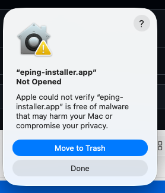
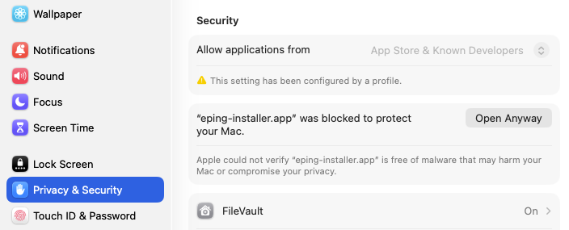
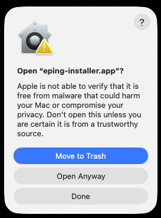
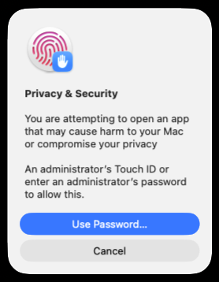
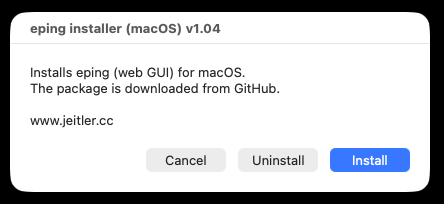

# eping for macOS

Web GUI version of [eping](https://github.com/ewaldj/eping) for macOS 10.13+ (Apple Silicon and Intel).
A small launcher app (`eping.app`) starts eping in the background, opens the web GUI and shows a small window with
Start / Stop / Restart / port / Open web GUI / Console log / Update. Same functions as the Windows version.
If the web port is in use, the launcher tries the next ports (up to 32) and shows the port actually used (orange note in the status line, port field updated).
The browser opens as soon as eping answers. Python 3.11 (for Apple Silicon and Intel) and fping 5.5 (universal) are included.

## Download

| Variant | File | Use |
|---|---|---|
| Installer | [eping-installer-mac.zip](https://github.com/ewaldj/eping/raw/main/OSX_Version/eping-installer-mac.zip) | Unzip, open `eping-installer.app`: downloads the package and installs it for the current user or all users |
| Portable | [eping-mac.zip](https://github.com/ewaldj/eping/raw/main/OSX_Version/eping-mac.zip) | Unzip anywhere and open `eping.app` |

## First start (apps are not notarized)

The apps are not notarized by Apple, so macOS blocks them on first start. This is a one-time step per app:

1. Unzip `eping-installer-mac.zip` and open `eping-installer.app`. macOS shows *Not Opened*. Press **Done** (not *Move to Trash*).

   

2. Open **System Settings / Privacy & Security**, scroll to *Security* and press **Open Anyway** next to the blocked app message.
   The message is shown for about one hour after the failed start.

   

3. Confirm with **Open Anyway** again.

   

4. Authenticate with Touch ID or the administrator password (**Use Password...**).

   

5. The installer starts. Press **Install** (see below).

   

The same applies to `eping.app` of the portable version.

Alternative without dialogs: run once in Terminal

```sh
xattr -dr com.apple.quarantine eping-installer.app   # or the eping-mac folder
```

The installer removes the flag from the installed eping files itself, so `eping.app` starts without this procedure after an installation.

## Installer

1. Open `eping-installer.app`, press Install.
2. Choose Current user (`~/Applications/eping`) or All users (`/Applications/eping`, asks for the admin password).
3. Start eping from the last dialog. Uninstall: open the installer again and press Uninstall (hosts files and logs are kept).

## Requirements

macOS 10.13+. Nothing else has to be installed: the `python-aarch64` / `python-x86_64` folders and `fping` in the eping folder are used first (system `python3` and Homebrew `fping` are only a fallback).

## Window

Below the buttons: checkboxes *Disable autostart* and *Disable logging* (`-dl`), *Disable file* (`-df`, no hosts file), a *CLI options* field (stored in `eping-args.txt` in the working folder) and a *Check updates* button. Settings (`eping-launcher.cfg`) apply at Start / Restart.

## Update

The launcher checks `eversions` on GitHub at start and every 6 hours. If `eping.py` / `epinga.py` are
newer, the Update button replaces them; if `eping-mac` is newer, the whole package is replaced.

## Notes

- The web GUI listens on 127.0.0.1 only; add `-bind 0.0.0.0` to the CLI options field (`eping-args.txt`) to reach it from the network.
- Terminal (curses) mode: run `eping.py` directly in Terminal.
- Details: <https://www.jeitler.cc>
- Working folder: `<home>/eping` - hosts file, logs, reports, `eping-console.log`, `eping-args.txt` and `eping-launcher.cfg` live there, so the program folder needs no write access. Change it with the *Working dir* field (paste a path, Enter confirms) or the *Change...* button (folder dialog); applied with Start / Restart, or with `-wd DIR` in the CLI options field (wins over the button) (hosts file, logs, reports and console log then use DIR). An `eping-args.txt` / `eping-launcher.cfg` found next to the program (older versions) is read until the first save; copy an existing `eping-hosts.txt` to the working folder once.
